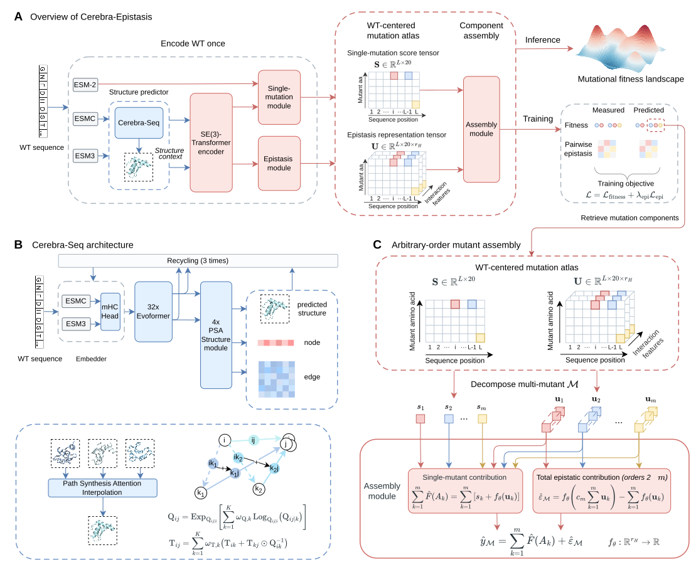
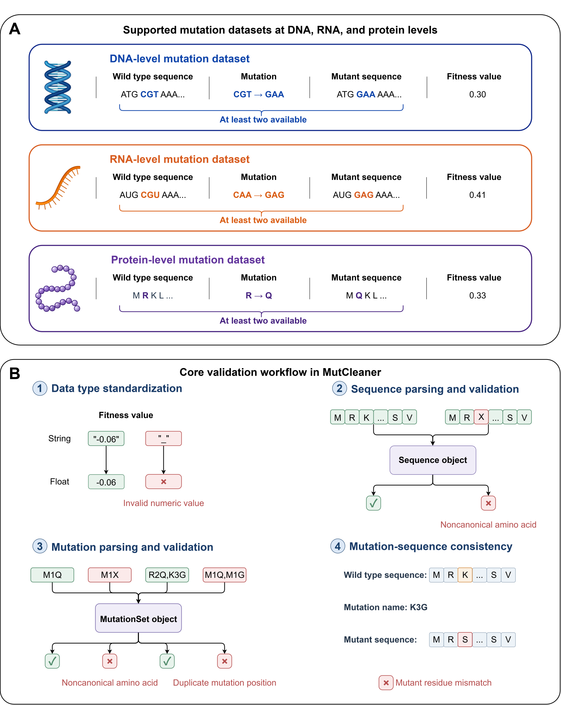

<h1>🗨 About Me</h1>

Hi! I'm **Shize Yu**, an undergraduate student in Software Engineering at [Huazhong University of Science and Technology](https://english.hust.edu.cn/).
My research lies at the intersection of AI and biology, with a focus on **protein design, protein engineering, and directed evolution**. I am interested in developing predictive and generative models that connect biological sequences and structures to function, and in using these models to guide experimental discovery. Specifically, I focus on the following areas:

- <button type="button" class="ra-trigger" data-ra-target="ra-modal-fitness" aria-haspopup="dialog">Protein fitness landscapes and epistasis1 paper</button>: learning how mutations interact and generalizing from measured variants to higher-order combinations.
- AI-guided protein engineering and directed evolution: combining computational modeling with experimental feedback to discover functional protein variants.
- Generative models for biological design: learning from biological sequences and structures to support protein and peptide design.
- <button type="button" class="ra-trigger" data-ra-target="ra-modal-data" aria-haspopup="dialog">Biological data and reproducible modeling1 paper</button>: building reliable resources and workflows for variant-effect prediction.

I am fortunate to work with [Yunxin Xu](https://xulab-research.yuque.com/r/organizations/homepage) at Zhongnan University of Economics and Law, [Shuyi Zhang](https://www.cssb.tsinghua.edu.cn/zh/core-staff/item/320-2019-10-31) at Tsinghua University, and [Duanhua Cao](https://life.tongji.edu.cn/6f/21/c12618a356129/page.htm) at Tongji University. Through these collaborations, I work across model development, dataset curation, computational evaluation, and experimental design.

<button type="button" class="ra-modal__close" data-ra-close aria-label="Close">&times;</button>
<h3 class="ra-modal__title" id="ra-modal-fitness-title">Protein fitness landscapes and epistasis</h3>

Related work.

<ul class="ra-reflist"><li>Wang, W.&#8224;, Yu, Z.&#8224;, Yang, E., Shi, Z., <strong>Yu, S.</strong>, Hu, J., Xu, Y.&#42;, &amp; Gong, H.&#42; (2026). From single-sequence structure prediction to protein fitness landscape through a composable, epistasis-aware mutation atlas. <em>bioRxiv</em>. <a href="https://doi.org/10.64898/2026.09.24.753701">Preprint</a>.</li></ul>

&#8224; Equal contribution. &#42; Corresponding author.

<button type="button" class="ra-modal__close" data-ra-close aria-label="Close">&times;</button>
<h3 class="ra-modal__title" id="ra-modal-data-title">Biological data and reproducible modeling</h3>

Related work.

<ul class="ra-reflist"><li>Shi, Z.&#8224;, Tang, Y.&#8224;, Yang, M., <strong>Yu, S.</strong>, Shi, Y., &amp; Xu, Y.&#42; (2026). MutCleaner: Cleaning and Standardizing Biological Mutation Datasets for Variant Effect Prediction. <em>bioRxiv</em>. <a href="https://doi.org/10.64898/2026.09.06.749687">Preprint</a>.</li></ul>

&#8224; Equal contribution. &#42; Corresponding author.

<h1 id="-educations">📖 Educations</h1>

- *2024 - Present*, B.Eng. student, Software Engineering. **Huazhong University of Science and Technology**, School of Software Engineering.

<h1 id="-news">📰 News</h1>

- *2026.09*: A paper I co-authored, “[From single-sequence structure prediction to protein fitness landscape through a composable, epistasis-aware mutation atlas](https://doi.org/10.64898/2026.09.24.753701),” is now available as a preprint on **bioRxiv**!
- *2026.09*: A paper I co-authored, “[MutCleaner: Cleaning and Standardizing Biological Mutation Datasets for Variant Effect Prediction](https://doi.org/10.64898/2026.09.06.749687),” is now available as a preprint on **bioRxiv**!
- *2026.07*: Started remote research with Duanhua Cao's group at Tongji University.
- *2026.05*: Our team was named a **Finalist** in the 2026 Mathematical Contest in Modeling (**MCM**)!

<strong>Earlier News (Click to Expand)</strong>

- *2025.07*: Participated in the School of Computing Summer Workshop at the National University of Singapore.
- *2024.09*: Started my undergraduate studies at Huazhong University of Science and Technology.

<h1 id="-selected-publications">📝 Selected Publications</h1>

<button type="button" id="toggleAllBtn" style="background-color:transparent;border:none;cursor:pointer;font-size:0.9em;font-weight:bold;padding:0;color:inherit;">Click to Close All</button>

In preprint

bioRxiv

[From single-sequence structure prediction to protein fitness landscape through a composable, epistasis-aware mutation atlas](https://doi.org/10.64898/2026.09.24.753701)

Weizhe Wang †, Zimu Yu †, Endi Yang, Ziyu Shi, **Shize Yu**, Jian Hu, Yunxin Xu &#42;, Haipeng Gong &#42;. *bioRxiv*, 2026.

<a class="citation-button" href="https://scholar.google.com/citations?view_op=view_citation&amp;hl=en&amp;user=jhlvw6sAAAAJ&amp;citation_for_view=jhlvw6sAAAAJ:d1gkVwhDpl0C">Citations</a>

bioRxiv

[MutCleaner: Cleaning and Standardizing Biological Mutation Datasets for Variant Effect Prediction](https://doi.org/10.64898/2026.09.06.749687)

Ziyu Shi †, Yuxiang Tang †, Mengxin Yang, **Shize Yu**, Yancheng Shi, Yunxin Xu &#42;. *bioRxiv*, 2026.

<a class="citation-button" href="https://scholar.google.com/citations?view_op=view_citation&amp;hl=en&amp;user=jhlvw6sAAAAJ&amp;citation_for_view=jhlvw6sAAAAJ:u5HHmVD_uO8C">Citations</a>

† Equal contribution. &#42; Corresponding author.

<h1 id="-experience">🧑‍💻 Experience</h1>

<ul class="education-timeline">
<li class="timeline-item-edu">

2026.07 - Present
<h4 class="title">Remote Undergraduate Researcher</h4>
Generative modeling for biological design | Advisor: <a href="https://life.tongji.edu.cn/6f/21/c12618a356129/page.htm">Duanhua Cao</a>

<a href="https://www.tongji.edu.cn/">Tongji University</a>, <a href="https://github.com/Intelligent-Drug-Discovery-Lab">Intelligent Drug Discovery (IDD) Lab</a>

</li>
<li class="timeline-item-edu">

2025.10 - Present
<h4 class="title">Remote Undergraduate Researcher</h4>
AI-guided protein engineering and directed evolution | Advisor: <a href="https://www.cssb.tsinghua.edu.cn/zh/core-staff/item/320-2019-10-31">Shuyi Zhang</a>

<a href="https://www.tsinghua.edu.cn/">Tsinghua University</a>, School of Pharmaceutical Sciences, Shuyi Zhang Lab

</li>
<li class="timeline-item-edu">

2025.04 - Present
<h4 class="title">Undergraduate Researcher</h4>
On-site research in protein fitness modeling and biological sequence learning | Advisor: <a href="https://xulab-research.yuque.com/r/organizations/homepage">Yunxin Xu</a>

<a href="https://www.zuel.edu.cn/">Zhongnan University of Economics and Law</a>, <a href="https://github.com/xulab-research">Xu Lab (xulab)</a>

</li>
</ul>

<h1 id="-honors-and-awards">🏅 Honors and Awards</h1>

__MCM_AWARD__

<h1 id="-service">📝 Service</h1>

- Co-reviewed a manuscript for **Communications Biology** (Nature Portfolio) with my supervisor; the contribution was recognized in the journal's March 2026 *Reviewer of the Month* feature.

